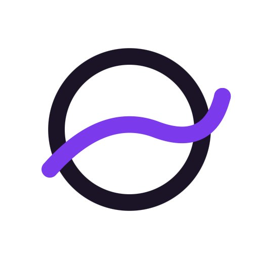
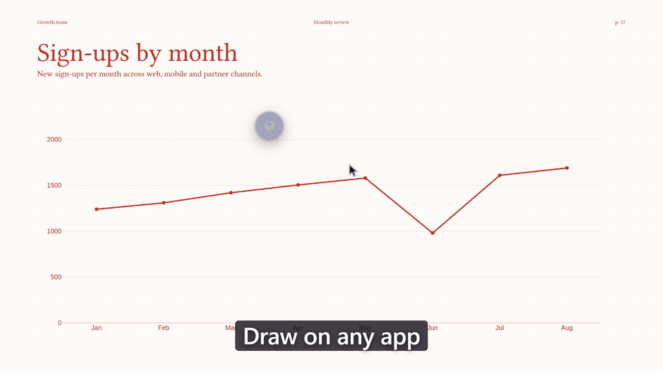

<p align="center">
  
</p>

<h1 align="center">OpenPen</h1>

<p align="center"><b>Your screen is the canvas. The tools are up to you.</b></p>

<p align="center">
  <a href="https://github.com/openpen-platform/openpen/releases/latest">Download</a> ·
  <a href="https://openpen.pages.dev/">Website</a> ·
  <a href="docs/README.md">Docs</a> ·
  <a href="https://github.com/openpen-platform/OpenPen-plugins">Plugins</a>
</p>

<p align="center">
  <a href="https://github.com/openpen-platform/openpen/releases/latest"></a>
  <a href="https://github.com/openpen-platform/openpen/actions/workflows/ci.yml"></a>
  <a href="LICENSE"></a>
</p>

<p align="center">
  
</p>

<p align="center"><sub>Background slide adapted from <a href="https://www.slidescarnival.com/template/minimalist-white-slides/237932">Minimalist White</a> by <a href="https://www.slidescarnival.com">SlidesCarnival</a>, licensed under <a href="https://creativecommons.org/licenses/by/4.0/">CC BY 4.0</a>. Changes: text and chart data replaced; the data is fictional.</sub></p>

OpenPen is a free, open-source screen annotation overlay for macOS, Windows and Linux.
Draw over any app — even full-screen ones — then fold it back into a floating ball so your presentation never skips a beat.

- **Draw on top of anything** — a transparent canvas above every app, with freehand, line, rectangle, ellipse and semi-transparent highlighter tools, adjustable stroke and color, and a gradient highlight mode.
- **Out of the way until you need it** — collapses to a floating ball that snaps to the screen edge.
- **Every tool is a plugin** — even the built-in ones, so you can swap, add or build your own.
- **Speaks your language** — English, 繁體中文, 简体中文 and 日本語, picked from your system language.

> [!WARNING]
> The installers are not code-signed yet, so your system may block the first launch.
>
> - **macOS:** open System Settings → Privacy & Security and click **Open Anyway**, or run `xattr -cr /Applications/OpenPen.app`.
> - **Windows:** in the SmartScreen prompt, click **More info** → **Run anyway**.

## Install

Download the installer for your platform from [GitHub Releases](https://github.com/openpen-platform/openpen/releases/latest):

- **macOS** — `.dmg` (Apple Silicon and Intel)
- **Windows** — `.exe` installer, or a portable `.exe`
- **Linux** — `.AppImage` (x86_64 and arm64). Full experience on X11; reduced on native Wayland, see [Linux & Wayland support](docs/troubleshooting/linux-wayland.md)

Building from source? See [CONTRIBUTING.md](CONTRIBUTING.md#development-setup).

## Every tool is a plugin — even ours

Built-in tools and third-party plugins use the same contract, slots and runtime APIs. Official plugins you can add today:

| Plugin | What it does |
| --- | --- |
| [arrow](https://github.com/openpen-platform/openpen-arrow) | Straight arrows with solid, open or hollow heads |
| [text](https://github.com/openpen-platform/openpen-text) | Click-to-type text annotations with IME-safe editing |
| [spotlight](https://github.com/openpen-platform/openpen-spotlight) | Dim the screen with a follow-cursor spotlight |
| [cursor-highlight](https://github.com/openpen-platform/openpen-cursor-highlight) | Cursor glow halo with click ripples |
| [whiteboard](https://github.com/openpen-platform/openpen-whiteboard) | One-tap whiteboard or blackboard backdrop |
| [step-marker](https://github.com/openpen-platform/openpen-step-marker) | Numbered markers for sequential annotations |

Build your own in about five minutes:

```bash
npx openpen-cli create @yourscope/my-plugin
```

[Tutorial](docs/tutorials/build-your-first-plugin.md) · [Slot reference](docs/slots/index.md) · [Architecture](docs/concepts/module-architecture.md)

Plugins run with full host access, so install only ones you trust — see the [trust model](docs/concepts/trust-model.md) and [SECURITY.md](SECURITY.md).

## Contributing

Bug reports, ideas, translations and pull requests are all welcome — open an [issue](https://github.com/openpen-platform/openpen/issues) or start a discussion. Development setup, build steps and how to add a language are in [CONTRIBUTING.md](CONTRIBUTING.md).

## License

The host app is [GPL-3.0-or-later](LICENSE) with a Linking Exception. The SDK packages (`@openpen/module-api`, `@openpen/build`, `openpen-cli`) are MIT, so plugins can use any license, including closed-source and commercial. Details and FAQ: [docs/licensing.md](docs/licensing.md).

© 2025-2026 OpenPen
